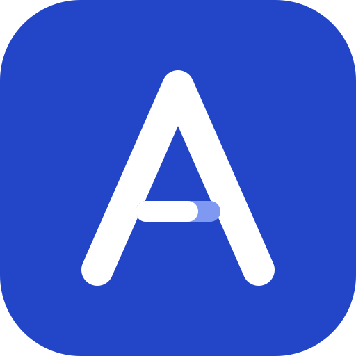
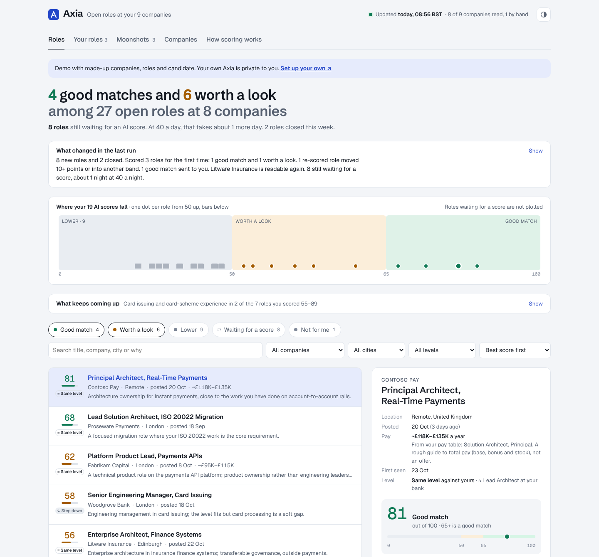
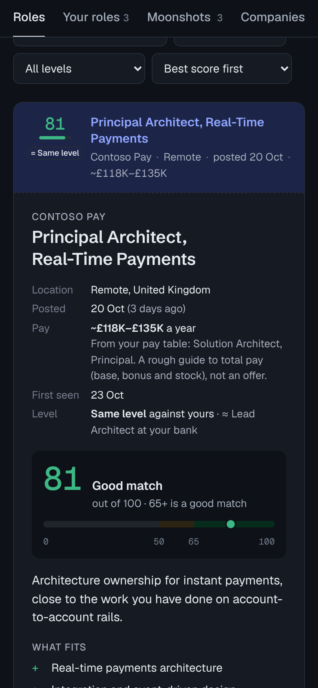

# Axia

[](https://github.com/khubli/axia/actions/workflows/test.yml) [](LICENSE)

**A private job radar for the companies you'd actually join.**

You list the employers you want to work for. Every morning Axia reads their own careers sites, has an AI model (Claude by default) read each role that fits against your resume and the criteria you wrote in your own words, and keeps the results on a dashboard only you can open. It messages you only when a role newly clears your bar.

**[Live demo](https://khubli.github.io/axia/)** (made-up companies, roles and candidate) · **[Set it up](docs/setup.md)** in about 30 minutes



## Why Axia

Most job-search tools start from a job board and a keyword search, then give you a generic match percentage. Axia starts from you: the employers you'd join, and how you judge a role.

- **You choose the companies.** No job-board firehose. Axia reads each employer's own careers system directly (Workday, Greenhouse, Lever, Ashby, SmartRecruiters, Oracle Recruiting Cloud, SAP SuccessFactors, Eightfold, TurboHire, Phenom, iCIMS, Avature, Talentsoft, plus Amazon, Google, Goldman Sachs, D. E. Shaw and Groupe BPCE) through the same public feeds their careers pages use. A site it can't read is listed as "check by hand", never silently dropped. Adding a company is one line.
- **Your title words, plus a second look.** Exact title words and places do the cheap first cut. Titles your words miss, like an employer's "Executive Manager" or "Chief Engineer", get a second look from the model, which can only let roles in, never keep one out.
- **Scored the way you would score it.** The model reads the full posting against your resume and `criteria.md`, where you write your hard stops, the gaps you'd accept, and the titles that fool you. `axia calibrate` measures how often it agrees with roles you have already judged, so you tune the wording until it scores like you. In the author's own use, that took agreement from 1 in 8 judged roles to 10 or 11 in 12.
- **Every gap is checkable.** Each score lists what the posting itself requires, quoted in its own words, and whether your resume shows it; a requirement it can't quote is dropped. Once a week the gaps that keep coming up across your close calls are grouped into a few themes, so you decide once whether to add the evidence to your resume or accept the gap.
- **Step up or step down, not just the title.** Each role is labelled against your current level. Titles mislead across employers (one bank's VP is another's Director), so the model goes by your `levels.md` ladder and the scope the posting describes, in the same request as the score.
- **A pay range on every role.** From the posting when it states pay (quoted and checked), from your own `pay.yml` table, or a rough AI estimate marked `~`. Same request as the score, and pay never moves the score. Axia never fetches pay sites.
- **It learns from your calls.** Mark a role Applied, Shortlist or Not for me on the dashboard. Once a week Axia checks its scores against your calls, and when a change to `criteria.md` would agree with you more often (proven by scoring your judged roles with and without it), it opens a pull request for you to merge or close. It never changes how it scores on its own.
- **It remembers.** Every role is tracked: new, open, closed, reopened. Each is scored once and announced once, re-scored only when your resume or criteria change (or never, if you'd rather), and dropped when the employer takes it down. The same job posted twice counts once, and only when the postings really are the same job. Roles you marked Applied or Shortlist stay on a **Your roles** tab even after they close.
- **It tells you what changed.** One line at the top of the dashboard says what the last run did: new and closed roles, first scores by band, messages sent, sites that broke or came back, and how long the waiting queue will take. Built by comparing runs, with no AI request. Spot a role far back in the queue? Shortlist it and the next run scores it first.
- **Quiet by design.** At most one message per run: roles that newly crossed your threshold, problems that last, and a silent weekly check-in. The dashboard holds everything else, with the reasons, strengths and gaps behind every score.
- **Private by construction.** Your resume, companies and scores live only in your own private repository and your own Cloudflare account. The dashboard sits behind your login, and after every publish Axia checks that a stranger is asked to sign in; if not, it takes your data down at once.
- **No servers, no extra bill.** It runs on GitHub Actions, the Claude Pro or Max subscription you may already have, Cloudflare's free plan and Telegram. No database, nothing to host.
- **Your choice of model.** Claude through your subscription or API key, or any model on OpenRouter (GPT, Gemini, Llama, Mistral…), or any OpenAI-compatible API. Switch with one line in `settings.yml`, and check the new model against your own verdicts with `axia calibrate`.
- **Shaped by plain files.** Companies, titles, places, thresholds, schedule, messages and criteria are text files in your repository. A new job site is one small file.
- **An app on your phone.** The dashboard installs as an app, opens instantly, works offline and refreshes itself, in light or dark.
- **Recent layoffs, as a heads-up (optional).** List layoff news you read in a `layoffs.yml` and the company and its roles carry a **Layoffs** label, India cuts shown more strongly, until it drops off six months later. Kept by hand, so it costs no AI requests and never touches a score.
- **Room for your own tools (optional).** A Moonshots tab shows stretch roles another tool of yours tracks, from a `moonshots.json` file. A Tailor button queues a role, with its posting text, for your own resume-tailoring workflow, and can start it at the click. Axia writes no resumes itself.

**What Axia is not:** not an auto-apply bot, not a LinkedIn or job-board scraper, not a resume rewriter, and not a hosted service. It tells you where to look and why. You decide, and you apply.

**Who it's for:** people with a shortlist of employers and a clear sense of the level and kind of role they want, who would rather hear about the right opening the day it appears than check a dozen careers sites.

<p align="center"></p>

## How it works

<picture>
  <source media="(prefers-color-scheme: dark)" srcset="docs/images/how-it-works-dark.png">
  
</picture>

Details, step by step: [docs/how-it-works.md](docs/how-it-works.md).

## How you use it

Axia's code (this repository) and your data live apart:

| | Holds | Visibility |
|---|---|---|
| **khubli/axia** | the engine, the dashboard, the GitHub Action, these docs | public |
| **your private repository** | `cv.md`, `criteria.md`, `companies.yml`, `settings.yml`, Axia's memory, the daily workflow | private |

Your repository's workflow is a few lines:

```yaml
- uses: actions/checkout@v5
- uses: khubli/axia@v1
  with:
    claude-code-oauth-token: ${{ secrets.CLAUDE_CODE_OAUTH_TOKEN }}
    telegram-bot-token: ${{ secrets.TELEGRAM_BOT_TOKEN }}
    telegram-chat-id: ${{ secrets.TELEGRAM_CHAT_ID }}
    cloudflare-api-token: ${{ secrets.CLOUDFLARE_API_TOKEN }}
    cloudflare-account-id: ${{ secrets.CLOUDFLARE_ACCOUNT_ID }}
```

**Start here: [docs/setup.md](docs/setup.md)** (about 30 minutes). A ready-to-copy private repository is in [`examples/instance/`](examples/instance/).

## Documentation

- [Set up Axia](docs/setup.md): your private repository, the AI model, Telegram, the Cloudflare-protected dashboard
- [Configuration](docs/configuration.md): every setting, the supported job sites, secrets
- [How it works](docs/how-it-works.md): reading, filtering, scoring, memory, messages, publishing, privacy

## Commands

The GitHub Action runs these for you. On your own computer, after `npm ci`:

```sh
node src/cli.mjs run --dir ../my-axia [--dry-run] [--no-notify] [--rescore] [--company Name] [--max-ai N]
node src/cli.mjs deploy --dir ../my-axia
node src/cli.mjs calibrate --dir ../my-axia
node src/cli.mjs review --dir ../my-axia --now   # the weekly review: would a criteria change agree with your calls more often?
node src/cli.mjs second-look --dir ../my-axia   # which titles your words miss today that the model would let through
node src/cli.mjs gaps --dir ../my-axia          # the gaps that keep coming up in your roles scored 55 to 89, grouped now (writes nothing)
node src/cli.mjs tailor-request --dir ../my-axia --id <role id> --out request.json   # one Tailor request with its posting text, for your tailoring workflow
npm test        # offline; job boards, AI models and Telegram are answered by recorded responses
```

## Responsible use

Axia reads public job feeds once a day with a clear user agent. It does not sign in anywhere, does not read LinkedIn, and does not apply for you. Check that a site's terms allow automated reading before you add it.

## Contributing

Bug reports, new job sites and fixes are welcome: see [CONTRIBUTING.md](CONTRIBUTING.md). Security reports: [SECURITY.md](SECURITY.md). Changes: [CHANGELOG.md](CHANGELOG.md).

## Brand

Icon, colours, type and the share image: [docs/brand](docs/brand/).

## How Axia was built

Krishna Tej Hubli designed and directed Axia: the problem, the requirements and constraints (privacy, cost, quiet messages), the product and architecture decisions, and the judged roles the scorer is calibrated against. The code, tests and docs were written by [Claude Code](https://claude.com/claude-code), Anthropic's coding agent, working from that direction. Every change was reviewed before it was merged, and every commit credits Claude as co-author.

## License

[MIT](LICENSE). The dashboard's fonts (Geist, Geist Mono, Schibsted Grotesk) are under the SIL Open Font License; see [src/dashboard/fonts](src/dashboard/fonts/).
