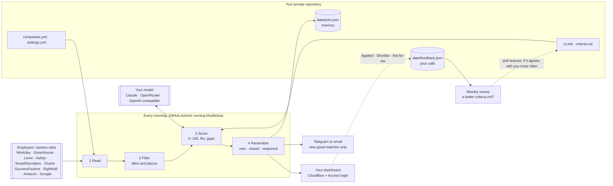

# How Axia works

One pass, once a day, in your own private repository's GitHub Actions:

## 1. Read

Each company's board is read through the JSON feed its own careers page uses: Workday, Greenhouse, Lever, Ashby, SmartRecruiters, Oracle Recruiting Cloud, SAP SuccessFactors, Eightfold, Amazon, Google and Goldman Sachs. Older SuccessFactors sites have no feed, so their search pages are read instead; Google's results pages carry their roles as data inside the page. Four boards at a time, with retries and backoff on errors. A board that cannot be read is reported, never treated as "no roles".

## 2. Filter (free)

A role is kept when its title contains one of your `titles.include` words and none of the `titles.exclude` words, and its location matches `locations.include`. Matching is by whole words, so "Intern" never removes "International" and "India" never matches "Indianapolis". When a board lists a role as "3 Locations", the posting is read to learn where it is. A job posted twice (same title, same place, same description) counts once; postings that share a title and place but describe different jobs stay separate, and if the descriptions can't be compared both are kept. Typically this keeps about 2% of everything listed.

**Second look.** Your title words are exact but only know the words you wrote, and employers name the same job in many ways ("Executive Manager", "Chief Engineer", "Chapter Lead", a grade written into the title). So roles in your places whose titles have none of your words, and none of your excluded words, get a second look: the model reads the titles alone, in batches, against your resume and `criteria.md`, and lets through any that could plausibly be in scope. It can only let roles in, never keep one out: what it lets through is read and scored in full like every other role, and if the model is unsure, wrong or unavailable nothing changes. Each employer + title is asked about once (again when your resume or criteria change), so after the first run it is a few dozen titles a day. Roles found this way carry a **Second look** label on the dashboard. To see what it would let through today, without changing anything: `axia second-look --dir <your folder>`. Turn it off with `titles.second_look: false`.

**Left out.** What the filters drop is listed on the dashboard's Companies tab, so you can spot-check it in a minute: the titles in your places that none of your title words matched and the second look didn't let in (or that have one of your excluded words), and the places outside your list where roles with a title you want were found, most roles first. A different spelling of a city you'd work in ("Bangalore" and "Bengaluru") shows up there straight away. The list comes from the last run and is not kept in memory.

## 3. Score (AI)

Roles are queued for the model most promising first: new roles before re-scores, then by a free estimate from the title and your keywords, then the newest posting. Up to `max_ai_scores_per_run` roles a run.

The model reads the full posting with your resume and `criteria.md` and returns a score from 0 to 100, a one-line summary, what fits and the gaps, written to you, plus up to four things the posting itself requires, quoted in its own words, each marked as shown in your resume, partly or not. A requirement whose quote isn't in the posting is dropped. Missing tools are soft gaps; a wrong function, level or location is a hard stop. Each role is scored once, and again only when `cv.md` or `criteria.md` changes, or when you run with **Re-score**.

Four ways to reach a model, chosen in `settings.yml` or by which secret is present: Claude Code on your Claude subscription (headless, no tools, a fixed answer format), the Claude API, any model on OpenRouter, or any other OpenAI-compatible API. The subscription and the OpenAI-compatible routes score 8 roles per request, so your resume is sent once per batch. With no model at all, every role gets a keyword estimate, shown as `≈`.

## 4. Remember

`data/jobs.json` is committed after every run, so its history is browsable and any bad run can be undone with `git revert`. A role closes when:

- its company's board was read and the role is no longer listed;
- its company's board could not be read for 7 days in a row (a shorter outage changes nothing);
- its company is removed from `companies.yml` or set `enabled: false`.

Closed roles leave the dashboard (it notes how many closed in the last week) and are forgotten after 45 days. Roles you marked Applied or Shortlist are the exception: they stay on the **Your roles** tab after they close, for good, from the copy of your calls in `data/feedback.json`. A role that reappears keeps its old score and is not announced again.

There is no age limit: a role stays while its employer lists it, because senior roles often take two or three months to fill. A role posted 45 or more days ago gets a **Long open** label, since an employer sometimes leaves a filled role up.

## 5. Tell you

At most **one message per run**, with up to three parts:

- **New good matches**: a role whose first AI score reaches your threshold. Each role once, ever. If no channel could deliver it, it is tried again on the next run.
- **Problems**: a board unreadable for 3 days running, or AI scoring failing on two runs in a row. Once per problem; cleared when it is fixed.
- **Weekly check-in**: on your chosen day, so a quiet week is never a silent failure. When it is the only part, it arrives without a sound.
- **Broken run**: the workflow sends the reason and a link to the log.

## 6. Publish

`axia deploy` uploads `.axia/site/` to Cloudflare as a static Worker on your domain. Version preview URLs and the `workers.dev` address are switched off, so your domain is the only way in. Then it requests the page as a stranger. A redirect to Cloudflare Access (or a 401/403) means private. Anything else, whether the page itself or no clear answer within about two minutes, and Axia immediately publishes a page with no data in its place and fails the run with instructions.

The dashboard is a single page with your data embedded: no server, no database, no third-party requests (fonts are served from your domain). Your filters and the last tab you used are remembered in your browser only.

It is also an installable app (PWA): add it to your phone's home screen or install it on a computer. A service worker keeps the last results you loaded on your device, so the app opens instantly and works offline. Online, the page is always fetched fresh, and when newer results are published while the app is open it offers a refresh.

**Gaps that keep coming up.** Once a week, when they have changed, the gaps of your open roles scored 55 to 89 (`gaps` in `settings.yml`) are grouped by the model into a few themes, each with the roles behind it, at the top of the dashboard. A theme that keeps coming up is a decision to make once: add the evidence to your resume if you have it, or accept the gap in `criteria.md`. Axia changes neither.

## 7. Learn from your calls

Each role on the dashboard has three buttons: **Applied**, **Shortlist** and **Not for me**, with a one-line reason if you like. They save to a Workers KV store in your Cloudflare account through the dashboard's own Worker, behind your login. Each run copies them into `data/feedback.json` in your repository, with the posting text, so they outlive the role.

Once a week (`review.day`) Axia checks whether its scores still agree with your calls. A call disagrees when you skipped a role that scored a good match, or wanted one that scored below. When some do:

1. The model reads every judged role (your call, your reason, its score, the posting) with your resume and `criteria.md`, and proposes the smallest edit to `criteria.md` that would fix the disagreements: general rules, in your own words and structure, never touching your resume.
2. Every judged role is scored twice in the same run, with today's criteria and with the proposal, so the comparison isn't thrown by the usual 5–10 point wobble between runs.
3. Only if the proposal agrees with your calls more often, and loses none of your `calibration/roles.yml` roles, is it opened as a pull request in your repository, with the edit, the roles whose score moves and the before/after numbers. You get a message with the link.

Nothing changes until you merge it. Merging re-scores your open roles over the next runs. Closing it turns the proposal down. One proposal is open at a time.

## Privacy

- Your resume, criteria, company list, scores and calls live only in your private repository, your Cloudflare account and the requests to the AI provider you chose, which score each role.
- Run logs list role titles and scores, which is why the workflow runs in your private repository and not in Axia's.
- Secrets are passed to the action as inputs and never printed.
