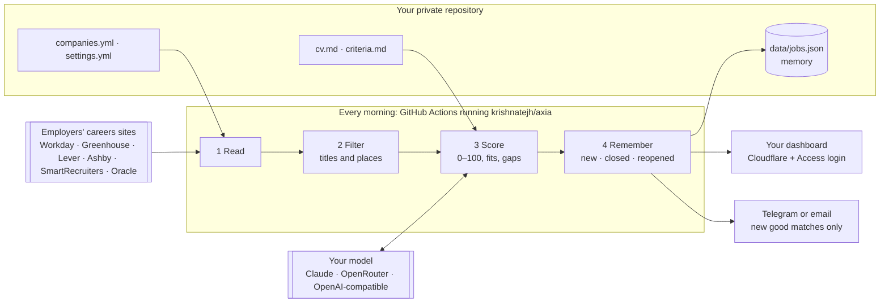

# How Axia works

One pass, once a day, in your own private repository's GitHub Actions:

## 1. Read

Each company's board is read through the JSON feed its own careers page uses: Workday, Greenhouse, Lever, Ashby, SmartRecruiters, Oracle Recruiting Cloud and Goldman Sachs. Four boards at a time, with retries and backoff on errors. A board that cannot be read is reported, never treated as "no roles".

## 2. Filter (free)

A role is kept when its title contains one of your `titles.include` words and none of the `titles.exclude` words, and its location matches `locations.include`. Matching is by whole words, so "Intern" never removes "International" and "India" never matches "Indianapolis". When a board lists a role as "3 Locations", the posting is read to learn where it is. The same title posted twice in the same city counts once. Typically this keeps about 2% of everything listed.

## 3. Score (AI)

Roles are queued for the model most promising first: new roles before re-scores, then by a free estimate from the title and your keywords, then the newest posting. Up to `max_ai_scores_per_run` roles a run.

The model reads the full posting with your resume and `criteria.md` and returns a score from 0 to 100, a one-line summary, what fits and the gaps, written to you. Missing tools are soft gaps; a wrong function, level or location is a hard stop. Each role is scored once, and again only when `cv.md` or `criteria.md` changes, or when you run with **Re-score**.

Four ways to reach a model, chosen in `settings.yml` or by which secret is present: Claude Code on your Claude subscription (headless, no tools, a fixed answer format), the Claude API, any model on OpenRouter, or any other OpenAI-compatible API. The subscription and the OpenAI-compatible routes score 8 roles per request, so your resume is sent once per batch. With no model at all, every role gets a keyword estimate, shown as `≈`.

## 4. Remember

`data/jobs.json` is committed after every run, so its history is browsable and any bad run can be undone with `git revert`. A role closes when:

- its company's board was read and the role is no longer listed;
- its company's board could not be read for 7 days in a row (a shorter outage changes nothing);
- its company is removed from `companies.yml` or set `enabled: false`.

Closed roles leave the dashboard (it notes how many closed in the last week) and are forgotten after 45 days. A role that reappears keeps its old score and is not announced again.

## 5. Tell you

At most **one message per run**, with up to three parts:

- **New good matches**: a role whose first AI score reaches your threshold. Each role once, ever. If no channel could deliver it, it is tried again on the next run.
- **Problems**: a board unreadable for 3 days running, or AI scoring failing on two runs in a row. Once per problem; cleared when it is fixed.
- **Weekly check-in**: on your chosen day, so a quiet week is never a silent failure. When it is the only part, it arrives without a sound.
- **Broken run**: the workflow sends the reason and a link to the log.

## 6. Publish

`axia deploy` uploads `.axia/site/` to Cloudflare as a static Worker on your domain. Version preview URLs and the `workers.dev` address are switched off, so your domain is the only way in. Then it requests the page as a stranger. A redirect to Cloudflare Access (or a 401/403) means private. Anything else, whether the page itself or no clear answer within about two minutes, and Axia immediately publishes a page with no data in its place and fails the run with instructions.

The dashboard is a single page with your data embedded: no server, no database, no third-party requests (fonts are served from your domain). Your filters and the last tab you used are remembered in your browser only.

It is also an installable app (PWA): add it to your phone's home screen or install it on a computer. A service worker keeps the last results you loaded on your device, so the app opens instantly and works offline. Online, the page is always fetched fresh, and when newer results are published while the app is open it offers a refresh.

## Privacy

- Your resume, criteria, company list and scores live only in your private repository, your Cloudflare account and the requests to the AI provider you chose, which score each role.
- Run logs list role titles and scores, which is why the workflow runs in your private repository and not in Axia's.
- Secrets are passed to the action as inputs and never printed.
